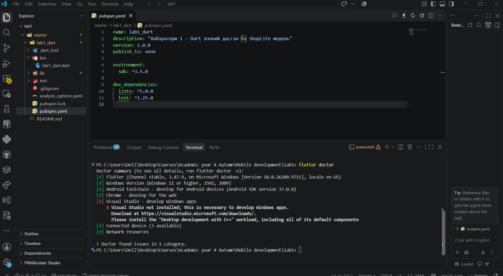

# ShopLite — Мобайл апп хөгжүүлэлт (Flutter)

**Нэр:** …  
**Оюутны код:** …

Энэ репозиторид 6 долоо хоногийн турш бүх лабораторийн кодоо хадгална.

```
├── README.md          ← энэ файл (доорх хэсгүүдийг бөглөнө)
├── screenshots/       ← дэлгэцийн зураг
├── lab1_dart/         ← Лаборатори 1: Dart дасгал
└── shoplite/          ← Лаборатори 1-д `flutter create`-оор үүсгэнэ
```

## Код хадгалах (лаборатори бүрийн төгсгөлд)

```bash
git add .
git commit -m "Lab 1: Dart модель, shoplite апп"
git push
git tag v0.1            # Лаб 1 → v0.1, Лаб 2 → v0.2, ...
git push origin v0.1
```

Push хийсний дараа GitHub дээрх **Actions** табаас автомат тестийн үр дүнг (ногоон ✓ / улаан ✗) харна.
`lab1_dart/test/` болон `.github/` хавтасны файлуудыг **өөрчлөхгүй**.

---

## Лаборатори 1




### lab1_dart

- `dart test test/lab1_test.dart`: … / 25
- Бонус B1 (`dart test test/bonus_test.dart`): хийсэн / хийгээгүй

### D2. Төслийн бүтэц

1. `lib/main.dart`-д ямар классууд байна? Аль нь StatelessWidget, аль нь StatefulWidget вэ?
   
   MyApp – StatelessWidget классаас удамшсан. Энэ нь аппликейшний үндсэн widget бөгөөд MaterialApp, theme болон эхлэх нүүр хуудсыг тодорхойлно. Доторх төлөв нь өөрчлөгддөггүй.

   MyHomePage – StatefulWidget классаас удамшсан. Энэ нь нүүр хуудасны widget бөгөөд өөрчлөгдөх боломжтой төлөвтэй.

   _MyHomePageState – MyHomePage-ийн төлөвийг хадгалдаг State класс. _counter хувьсагчийг хадгалж, _incrementCounter() функцээр утгыг нэмэгдүүлдэг. setState() дуудагдахад дэлгэц дахин шинэчлэгдэнэ.


2. `pubspec.yaml`-д ямар сангууд байна?
   pubspec.yaml файлд төслийн ашиглах сангууд болон тэдгээрийн хувилбаруудыг тодорхойлдог.

   Dependencies:

   flutter: Flutter SDK-ийн үндсэн сан.
   cupertino_icons: ^1.0.8: iOS загварын дүрс тэмдгүүдийг ашиглах сан.
   
   Dev Dependencies:
   flutter_test: Flutter аппликейшний тест бичих, ажиллуулах сан.
   flutter_lints: ^6.0.0: Кодын чанар болон зөв бичиглэлийг шалгах дүрмийн сан.
   
   Мөн uses-material-design: true тохиргоо нь Material Design-ийн дүрс тэмдгүүдийг ашиглах боломж олгодог.

3. `android/` хавтас юунд хэрэгтэй вэ? Та ихэвчлэн аль хавтсанд код бичих вэ?
   android/ хавтас нь Flutter аппликейшнийг Android үйлдлийн систем дээр ажиллуулахад шаардлагатай платформын тохиргоо болон native Android файлуудыг агуулдаг.
   
   Үүнд:
   Gradle тохиргоо болон build файлууд.
   AndroidManifest.xml файл.
   Kotlin эсвэл Java хэл дээр бичигдсэн Android код.
   Android SDK болон NDK-тэй холбоотой тохиргоо.

   Бид ихэвчлэн lib/ хавтсанд код бичнэ. Учир нь Flutter аппликейшний үндсэн код, дэлгэцийн загвар (UI), widget болон програмын логикийг Dart хэлээр энэ хавтсанд бичдэг.

### D4. Hot reload ба hot restart

| Өөрчлөлт | Hot reload (r) | Hot restart (R) |
|---|---|---|
| AppBar-ийн гарчгийг өөрчлөх | Гарчиг хэсэг өөрчлөгдсөн, Программын тоолуур 3 байна. | Гарчиг хэсэг өөрчлөгдсөн хэвээр, тоолуур 0 болсон.|
| seed өнгийг солих | Программын өнгө өөрчлөгдсөн. /Тоолуур 3 байна./ | Өнгө өөрчлөгдсөн хэвээр, тоолуур 0 болсон.|
| `int _count = 0;` → `= 5` | Тоолуурын утга 3 хэвээр| Тоолуурын утга 5 болсон.|
| `main()` дотор `print('start');` нэмэх | Өөрчлөгдсөн зүйл байхгүй.| Terminal хэсэгт start харагдаж байна. |

**Дүгнэлт:** аль тохиолдолд тоолуурын утга (state) хадгалагдсан бэ? Яагаад?
Дээрх даалгаврын үр дүнд Hot reload (r)-ийн үеэр тоолуурын утга хадгалагдсан.

Учир нь Hot reload нь өөрчлөгдсөн кодыг ажиллаж байгаа апп руу оруулаад зөвхөн `build()` методуудыг дахин ажиллуулдаг. `State` объект устгагдахгүй тул `_counter`-ийн утга хадгалагдана. Харин `main()` функц болон хувьсагчийн анхны утга (`int _counter = 5;`) зэрэг нэг л удаа ажилладаг код дахин ажиллахгүй. Hot restart нь аппын бүх state-ийг устгаж, `main()`-ээс эхлэн бүх зүйлийг шинээр үүсгэдэг тул тоолуур анхны утгаасаа эхэлдэг.
